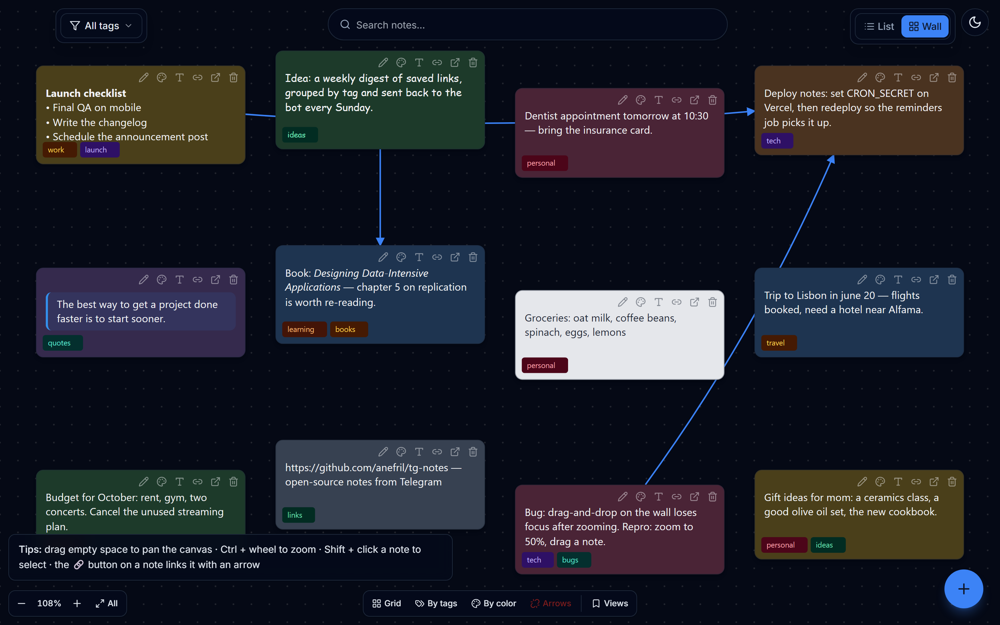
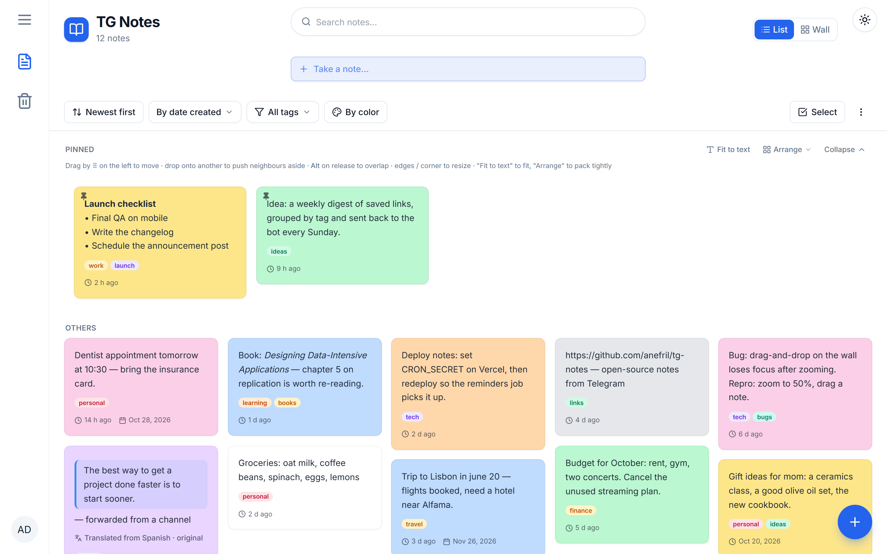
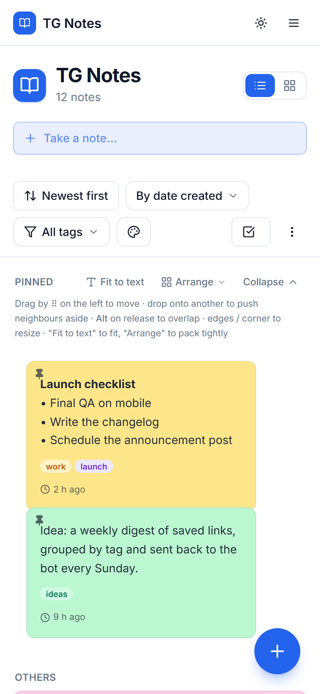
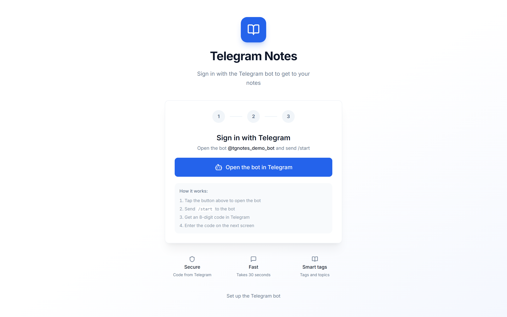

# TG Notes

**Send anything to a Telegram bot — it lands as a note on your own website.**

Text, links, photos, videos, voice messages and files sent to the bot become notes on a personal web app: a Google Keep-style list, a free-form sticky-note **wall** with arrows between notes, tags, search, trash and reminders. The bot deletes your message right after saving, so the chat stays clean.



| List view | Mobile |
|---|---|
|  |  |



<sub>Screenshots use made-up demo notes.</sub>

## Features

**Bot**
- Save text, links, photos, videos, voice messages, audio and documents (files stored in Supabase Storage)
- Forwarded posts keep their formatting — bold, italic, quotes, code, links
- Auto-translation of foreign-language posts to English, with a "show original" toggle
- Duplicate detection, batched "Saving… (5 notes)" status, `/recent`, `/stats`, `/clear`
- Daily reminders for notes that mention a date ("tomorrow", "in 3 days", "june 20")
- Passwordless sign-in: `/start` gives a one-time 8-digit code for the website

**Website**
- List view with pinning, drag-to-reorder, resizing and colour grouping
- **Wall** view: an infinite canvas of sticky notes, curved/straight arrows between them, zoom, grid / by-tag / by-colour layouts, saved views, undo
- Tags with custom colours, bulk select → tag / colour / pin / trash
- Rich-text editing, full-text search (Ctrl+K), shareable public links
- Trash with 30-day retention, export to JSON / Markdown, dark mode, mobile layout

## Stack

Next.js 13 (App Router) · TypeScript · Tailwind CSS + shadcn/ui · Supabase (Postgres, Auth, Storage, row-level security) · Vercel (hosting + cron)

## Run your own

1. **Supabase** — create a project, open *SQL Editor* and run [`supabase/setup.sql`](supabase/setup.sql) (safe to re-run). In *Auth settings* turn off "Confirm email".
2. **Environment** — copy [`.env.local.example`](.env.local.example) to `.env.local` and fill it in (Supabase keys, your site URL, `ADMIN_SECRET`, `CRON_SECRET`).
3. **Deploy** — push to Vercel with the same environment variables. `vercel.json` schedules the daily reminders cron.
4. **Bot** — create a bot with [@BotFather](https://t.me/BotFather), open `https://your-site/setup`, paste the token and your `ADMIN_SECRET`. The server sets the webhook, commands and description.
5. Send `/start` to your bot, enter the code on the website — done.

Local development:

```bash
npm install
npm run dev        # http://localhost:3000
npm run typecheck
```

## Security notes

- Row-level security on every table; the service-role key is only used server-side.
- Sign-in codes and the bot token are never readable by the browser.
- Telegram webhook requests are verified with a secret token.
- Note HTML is sanitized; only `http(s)` links are allowed.
- Auto-translation sends note text to Google Translate — remove `translateToEnglish` in the webhook if you don't want that.
